# Практическая работа №2

## Цель работы

Научиться строить и исследовать регулярные выражения (РВ), регулярные грамматики и конечные автоматы (КА), переводить их друг в друга, а также доказывать принадлежность языка к классу регулярных языков (РЯ) или его нерегулярность с помощью леммы о разрастании.


## Задание

1. С помощью JFLAP построить регулярное выражение, описывающее заданный язык, или формально доказать, что это невозможно. Привести обобщенный граф переходов и эквивалентный КА, а также пошаговое выполнение преобразований.
2. С помощью JFLAP построить регулярную грамматику, описывающую заданный язык, или формально доказать, что это невозможно. Привести эквивалентный КА и РВ, а также пошаговое выполнение преобразований.
3. Формально доказать принадлежность или непринадлежность заданных языков к классу РЯ с использованием леммы о разрастании регулярных языков.


## Вариант

**Вариант 19.** Язык L19 над алфавитом {a, b}: длина любой строки делится нацело на 3.


## Ход работы

### 1. Выполнение первого задания

#### 1.1 Построение регулярного выражения

Любая строка из L19 состоит из нескольких блоков по 3 символа. Один блок — это три произвольных символа подряд, каждый из которых равен `a` или `b`:

```
(a+b)(a+b)(a+b)
```

Любая строка нужной длины получается повторением такого блока, поэтому ставим `*`:

```
r = ((a+b)(a+b)(a+b))*
```

#### 1.2 Обобщенный граф переходов с одной дугой

Начальный вид для выражения: два состояния, `q0` (начальное) и `q1` (конечное), и между ними одна дуга, помеченная всем регулярным выражением.

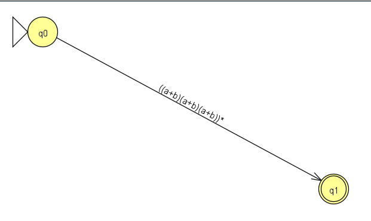

Это стартовая точка преобразования «РВ → КА»: на каждом следующем шаге JFLAP заменяет сложную метку на более простые.

#### 1.4 КА, построенный из регулярного выражения

Ниже показана последовательность шагов построения.

**Шаг 1.** Между `q0` и `q1` добавлены λ-переходы (в обе стороны), а выражение `((a+b)(a+b)(a+b))` вынесено на дугу между `q2` и `q3`.

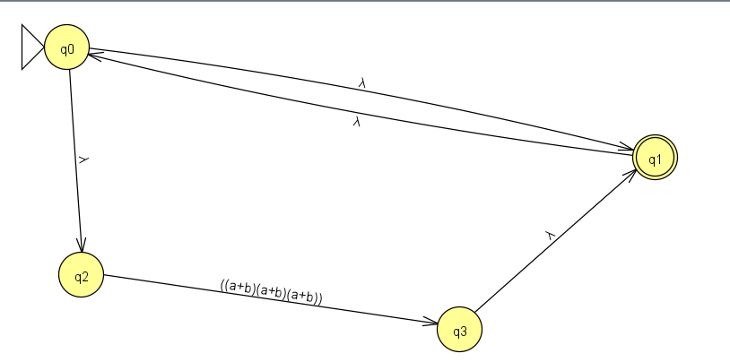

**Шаг 2.** Раскрыта конкатенация. Дуга разбилась на три последовательные дуги `(a+b)`, соединенные λ-переходами (состояния `q4 … q9`).

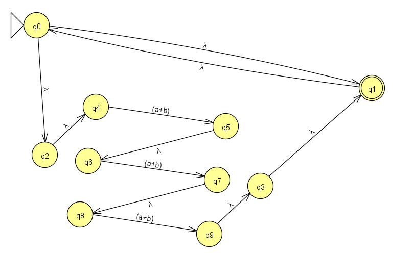

**Шаг 3.** Раскрыто объединение в первой дуге: вместо `(a+b)` появились два альтернативных пути, по `a` и по `b` (состояния `q10 … q13`).

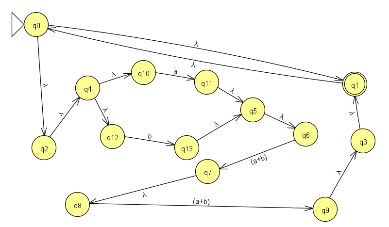

**Шаг 4.** То же сделано для второй и третьей дуг. Получен полный КА без составных меток: все дуги помечены одиночными символами или λ.

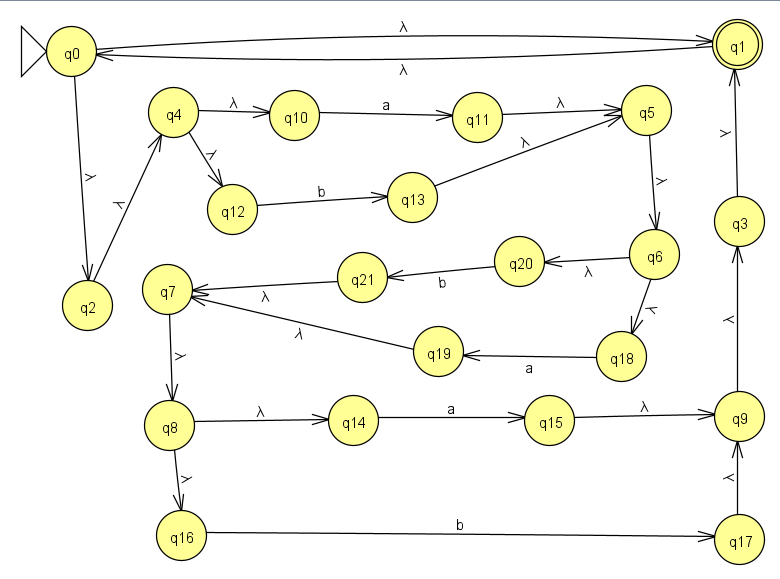

**Проверка работы автомата** 

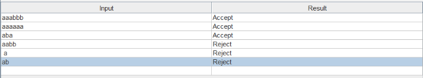

---

### 2. Выполнение второго задания

#### 2.1 Построение праволинейной грамматики

Идея та же, что и в автомате: нужно помнить остаток длины строки по модулю 3. Для этого вводим три нетерминала:

| Нетерминал | Что означает |
|------------|--------------|
| `S` | прочитано символов ≡ 0 (mod 3), начальное состояние |
| `A` | прочитано символов ≡ 1 (mod 3) |
| `B` | прочитано символов ≡ 2 (mod 3) |

Грамматика в JFLAP:

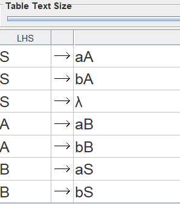

#### 2.2 Построение КА по грамматике

В JFLAP режим *Convert → Convert Grammar to FA* строит автомат по одному правилу за шаг. Принцип преобразования:

- каждому нетерминалу соответствует состояние автомата (`S`, `A`, `B`);
- правило `X → cY` превращается в переход из `X` в `Y` по символу `c`;
- правило `X → λ` превращается в λ-переход из `X` в новое конечное состояние.

Сначала создаются состояния (`q2` для `S` — начальное, `q0` для `A`, `q1` для `B`) и дополнительное конечное состояние `q3`:

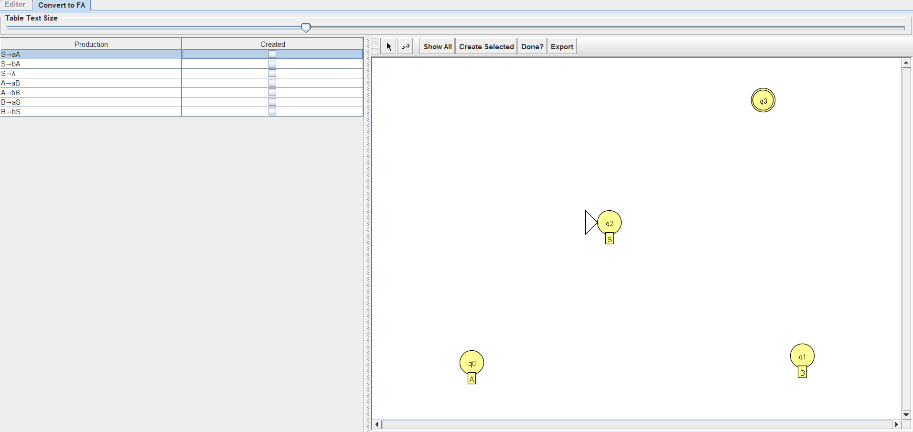


Затем по очереди добавляются переходы, соответствующие правилам:

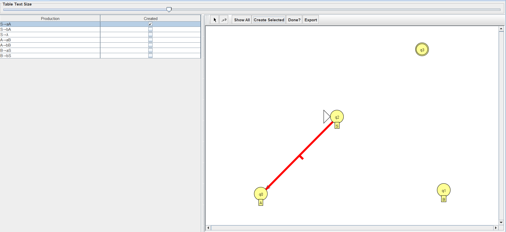
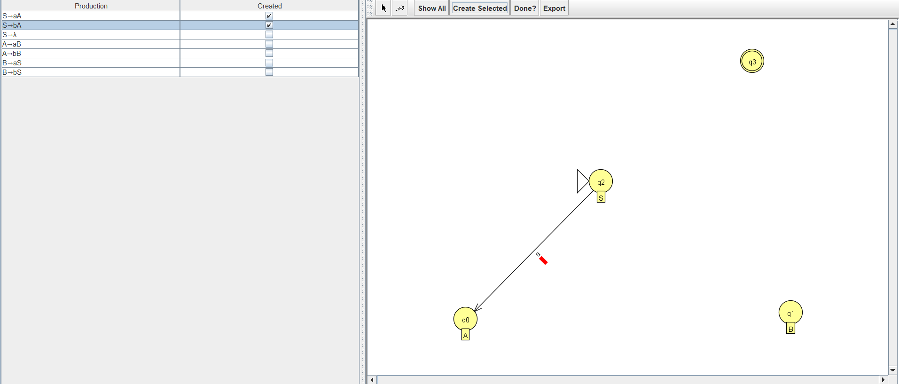
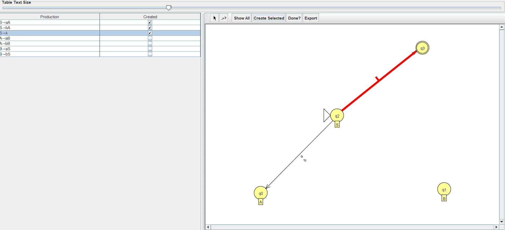
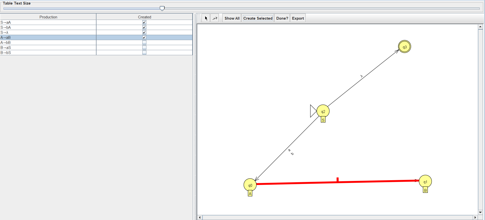
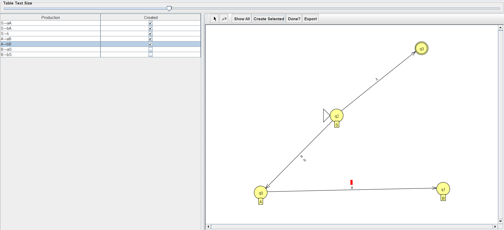
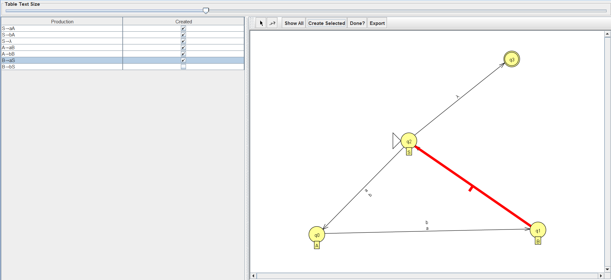

После обработки всех семи правил (в таблице отмечены все галочки) автомат готов: `S → A → B → S` по символам `a` и `b` и переход по λ из `S` в конечное состояние `q3`.

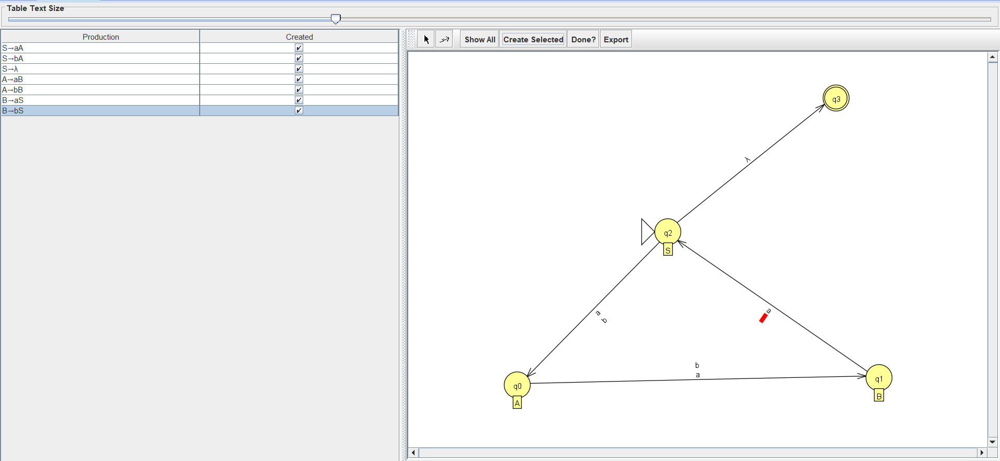

#### 2.3 Промежуточное тестирование

Полученный автомат проверяется на тех же цепочках, что и ДКА в первом задании. Цепочки `aaabbb`, `aaaaaa`, `aba` принимаются, `aabb`, `a`, `ab` отвергаются. Поведение совпадает с автоматом из задания 1, значит, грамматика задает тот же язык L₁₉.


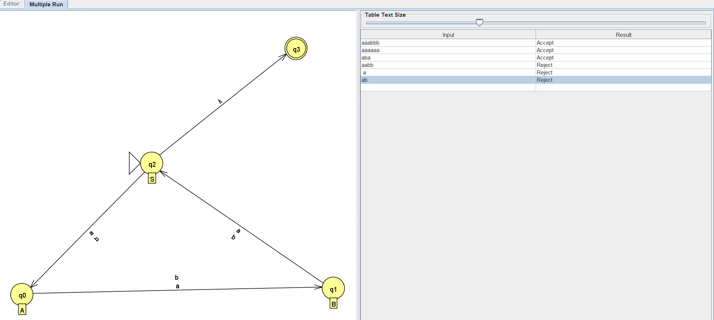

#### 2.4 Преобразование конечного автомата в регулярное выражение

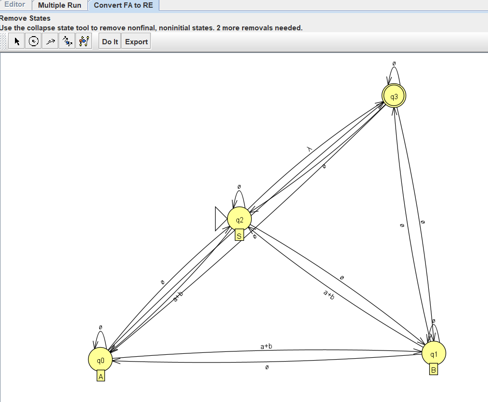

После удаления промежуточных состояний на начальном состоянии `S` остается петля `(a+b)(a+b)(a+b)` (три шага по кругу `S → A → B → S`), а в конечное состояние ведет λ-переход:

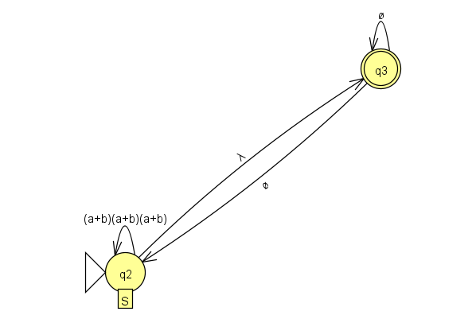

Итоговое регулярное выражение, которое выдал JFLAP, совпадает с выражением из задания 1:

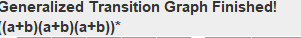

```
((a+b)(a+b)(a+b))*
```

---

3. Выполнение третьего задания

Язык: L₃₂ = { ww : w ∈ {a, b}* } — множество строк, являющихся «удвоением» некоторой строки w (например, ε, aa, abab, aabaab).

Утверждение. L₃₂ не является регулярным языком.

3.1 Формулировка леммы о разрастании

Если язык L регулярный, то существует число p ≥ 1 (длина накачки) такое, что любую строку s ∈ L с |s| ≥ p можно разбить на s = xyz, где:

|y| ≥ 1;
|xy| ≤ p;
для всех i ≥ 0 строка xyⁱz ∈ L.

Лемма дает необходимое, но не достаточное условие регулярности, поэтому с ее помощью можно доказывать только нерегулярность языка: достаточно показать, что для некоторой строки из L ни одно допустимое разбиение не удовлетворяет условию 3.

3.2 Доказательство нерегулярности L₃₂

Доказываем от противного. Пусть L₃₂ регулярный, и пусть p — длина накачки из леммы.

Выбор строки. Возьмем w = aᵖb и

s = ww = aᵖb aᵖb.

Тогда s ∈ L₃₂ и |s| = 2p + 2 ≥ p, значит, лемма применима к s.

Разбиение. По лемме s = xyz, где |y| ≥ 1 и |xy| ≤ p. Первые p символов строки s — это все символы a первого блока aᵖ, поэтому xy целиком лежит внутри этого блока, и

x = aᵐ, y = aᵏ, z = aᵖ⁻ᵐ⁻ᵏ b aᵖ b, где k ≥ 1, m ≥ 0, m + k ≤ p.

Накачка (i = 2). Получаем

s' = xy²z = aᵖ⁺ᵏ b aᵖ b.

Покажем, что s' ∉ L₃₂. Допустим, s' = uu для некоторой строки u.

В s' ровно два символа b, значит, в каждой из двух одинаковых половин u должно быть ровно по одному b.
Длина s' равна 2p + 2 + k. Если k нечетно, длина нечетна и s' не может быть равна uu. Пусть k четно, тогда |u| = p + 1 + k/2.
Первое b в s' стоит на позиции p + k + 1. Так как k ≥ 1, имеем p + k + 1 > p + 1 + k/2 = |u|, то есть первое b находится во второй половине строки. Значит, первая половина u состоит только из a и не содержит b, а вторая половина содержит b. Но первая и вторая половины должны совпадать.

Получено противоречие, следовательно, s' ∉ L₃₂.

Итог. Для выбранной строки s ∈ L₃₂ любое разбиение s = xyz, удовлетворяющее условиям 1 и 2, нарушает условие 3 (при i = 2 получаем строку не из L₃₂). Это противоречит лемме о разрастании, поэтому предположение о регулярности неверно.

Вывод: язык L₃₂ = { ww : w ∈ {a, b}* } не является регулярным. Следовательно, для него нельзя построить ни регулярное выражение, ни регулярную грамматику, ни конечный автомат.

Вывод

В ходе работы освоены взаимные преобразования между регулярными выражениями, конечными автоматами и регулярными грамматиками в JFLAP. Для языка L₁₉ (длина строки кратна 3) получено следующее:

регулярное выражение ((a+b)(a+b)(a+b))*;
эквивалентные КА (с λ-переходами), который хранит остаток длины строки по модулю 3;
праволинейная грамматика S → aA | bA | λ, A → aB | bB, B → aS | bS, по которой построен КА и затем получено то же самое регулярное выражение.

Правильность построений подтверждена прогонами на контрольных цепочках. С помощью леммы о разрастании доказано, что язык L₃₂ = {ww : w ∈ {a, b}*} не является регулярным.
