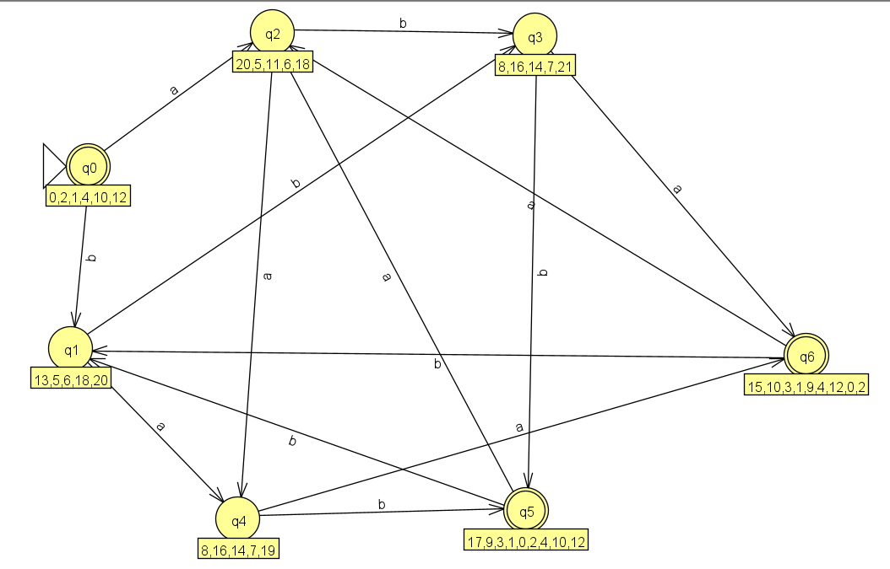
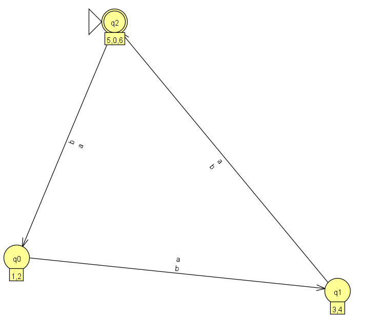

# Практическая работа №2

## Цель работы

Научиться строить и исследовать регулярные выражения (РВ), регулярные грамматики и конечные автоматы (КА), переводить их друг в друга, а также доказывать принадлежность языка к классу регулярных языков (РЯ) или его нерегулярность с помощью леммы о разрастании.


## Задание

1. С помощью JFLAP построить регулярное выражение, описывающее заданный язык, или формально доказать, что это невозможно. Привести обобщенный граф переходов и эквивалентный КА, а также пошаговое выполнение преобразований.
2. С помощью JFLAP построить регулярную грамматику, описывающую заданный язык, или формально доказать, что это невозможно. Привести эквивалентный КА и РВ, а также пошаговое выполнение преобразований.
3. Формально доказать принадлежность или непринадлежность заданных языков к классу РЯ с использованием леммы о разрастании регулярных языков.


## Вариант

**Вариант 19.** Язык L19 над алфавитом {a, b}: длина любой строки делится нацело на 3.


## Ход работы

### 1. Выполнение первого задания

#### 1.1 Построение регулярного выражения

Любая строка из L19 состоит из нескольких блоков по 3 символа. Один блок — это три произвольных символа подряд, каждый из которых равен `a` или `b`:

```
(a+b)(a+b)(a+b)
```

Любая строка нужной длины получается повторением такого блока, поэтому ставим `*`:

```
r = ((a+b)(a+b)(a+b))*
```

#### 1.2 Обобщенный граф переходов с одной дугой

Начальный вид для выражения: два состояния, `q0` (начальное) и `q1` (конечное), и между ними одна дуга, помеченная всем регулярным выражением.


Это стартовая точка преобразования «РВ → НКА»: на каждом следующем шаге JFLAP заменяет сложную метку на более простые.

#### 1.4 НКА, построенный из регулярного выражения

Ниже показана последовательность шагов построения.

**Шаг 1.** Между `q0` и `q1` добавлены λ-переходы (в обе стороны), а выражение `((a+b)(a+b)(a+b))` вынесено на дугу между `q2` и `q3`.


**Шаг 2.** Раскрыта конкатенация. Дуга разбилась на три последовательные дуги `(a+b)`, соединенные λ-переходами (состояния `q4 … q9`).


**Шаг 3.** Раскрыто объединение в первой дуге: вместо `(a+b)` появились два альтернативных пути, по `a` и по `b` (состояния `q10 … q13`).


**Шаг 4.** То же сделано для второй и третьей дуг. Получен полный НКА без составных меток: все дуги помечены одиночными символами или λ.


#### 1.5 Конвертация в ДКА, минимизация ДКА и проверка

**Преобразование НКА в ДКА** (алгоритм построения подмножеств). Каждое состояние ДКА соответствует *множеству* состояний НКА, в которых автомат может оказаться после чтения данной строки (с учетом λ-замыканий). Множества подписаны под состояниями на схеме. Конечными становятся те состояния ДКА, в чье множество входит конечное состояние НКА (`q1`).

В результате получился ДКА из 7 состояний. Он избыточен: многие состояния эквивалентны.



**Минимизация ДКА.** Алгоритм объединяет неразличимые состояния. Результат — ДКА из **трех состояний**:

- состояние, подписанное `5,0,6`, — начальное и конечное (длина строки ≡ 0 mod 3);
- состояние `1,2` — длина ≡ 1 (mod 3);
- состояние `3,4` — длина ≡ 2 (mod 3).

Из каждого состояния по `a` и по `b` есть переход в следующее по кругу, то есть автомат просто считает длину строки по модулю 3.



**Проверка работы автомата** 


---

### 2. Выполнение второго задания

#### 2.1 Построение праволинейной грамматики

Идея та же, что и в автомате: нужно помнить остаток длины строки по модулю 3. Для этого вводим три нетерминала:

| Нетерминал | Что означает |
|------------|--------------|
| `S` | прочитано символов ≡ 0 (mod 3), начальное состояние |
| `A` | прочитано символов ≡ 1 (mod 3) |
| `B` | прочитано символов ≡ 2 (mod 3) |

Грамматика в JFLAP:


#### 2.2 Построение КА по грамматике

В JFLAP режим *Convert → Convert Grammar to FA* строит автомат по одному правилу за шаг. Принцип преобразования:

- каждому нетерминалу соответствует состояние автомата (`S`, `A`, `B`);
- правило `X → cY` превращается в переход из `X` в `Y` по символу `c`;
- правило `X → λ` превращается в λ-переход из `X` в новое конечное состояние.

Сначала создаются состояния (`q2` для `S` — начальное, `q0` для `A`, `q1` для `B`) и дополнительное конечное состояние `q3`:


Затем по очереди добавляются переходы, соответствующие правилам:


После обработки всех семи правил (в таблице отмечены все галочки) автомат готов: `S → A → B → S` по символам `a` и `b` и переход по λ из `S` в конечное состояние `q3`.


#### 2.3 Промежуточное тестирование

Полученный автомат проверяется на тех же цепочках, что и ДКА в первом задании. Цепочки `aaabbb`, `aaaaaa`, `aba` принимаются, `aabb`, `a`, `ab` отвергаются. Поведение совпадает с автоматом из задания 1, значит, грамматика задает тот же язык L₁₉.


#### 2.4 Преобразование конечного автомата в регулярное выражение


После удаления промежуточных состояний на начальном состоянии `S` остается петля `(a+b)(a+b)(a+b)` (три шага по кругу `S → A → B → S`), а в конечное состояние ведет λ-переход:


Итоговое регулярное выражение, которое выдал JFLAP, совпадает с выражением из задания 1:


```
((a+b)(a+b)(a+b))*
```

---

### 3. Выполнение третьего задания

**Язык:** L₁₉ = { w ∈ {a, b}\* : |w| ≡ 0 (mod 3) }.

#### 3.1 Формулировка леммы

Если язык L регулярный, то существует число p ≥ 1 (длина накачки) такое, что любую строку w ∈ L с |w| ≥ p можно разбить на w = xyz, где:

1. |y| ≥ 1
2. |xy| ≤ p
3. для всех i ≥ 0 строка xyⁱz ∈ L

**Важное замечание.** Лемма дает *необходимое, но не достаточное* условие регулярности. Это значит:

- Для доказательства **нерегулярности** лемма подходит: нужно от противного показать, что условия леммы не выполняются ни при каком разбиении.
- Для доказательства **регулярности** лемма не подходит: существуют нерегулярные языки, для которых условия леммы выполняются.

Поэтому для L19 вывод делается в два этапа:

1. Принадлежность классу РЯ доказывается *построением* (ДКА, РВ, праволинейная грамматика): это части 1 и 2 работы.
2. Лемма применяется для согласованности: нужно показать, что условия леммы для L19 выполняются, то есть противоречия нет.

#### 3.2 Принадлежность L₁₉ классу РЯ

**ДКА.** Автомат A = ({q₀, q₁, q₂}, {a, b}, δ, q₀, {q₀}), где δ(qₖ, c) = q₍ₖ₊₁₎ mod 3 для c ∈ {a, b}.

Индукцией по |w| получаем δ\*(q₀, w) = q₍|w| mod 3₎:

- *База:* для w = ε имеем δ\*(q₀, ε) = q₀ = q₀ mod 3.
- *Шаг:* если δ\*(q₀, w) = q₍|w| mod 3₎, то после чтения символа c автомат переходит в q₍(|w|+1) mod 3₎.

Значит, A принимает w тогда и только тогда, когда |w| ≡ 0 (mod 3), то есть L(A) = L₁₉.

**Регулярное выражение:** r = ((a+b)(a+b)(a+b))\*. Выражение (a+b)(a+b)(a+b) задает все строки длины 3. Звездочка дает любую конкатенацию таких блоков, то есть ровно строки, длина которых кратна 3, включая ε (нуль блоков).

**Грамматика:** S → aA | bA | λ, A → aB | bB, B → aS | bS. Нетерминалы S, A, B соответствуют остаткам длины 0, 1, 2 по модулю 3.

Каждая из этих конструкций сама по себе доказывает, что **L₁₉ ∈ REG**.

#### 3.3 Проверка условий леммы для L₁₉

**Утверждение.** Для L₁₉ условия леммы выполняются с p = 3.

**Доказательство.** Пусть w = w₁w₂…wₙ ∈ L₁₉ и |w| = n ≥ 3. Так как 3 | n и n ≥ 3, строка непустая и имеет длину не менее 3. Положим:

- x = ε,
- y = w₁w₂w₃,
- z = w₄…wₙ.

Проверим условия:

1. |y| = 3 ≥ 1.
2. |xy| = 3 ≤ p.
3. Для любого i ≥ 0: |xyⁱz| = 3i + (n − 3) = n + 3(i − 1). Поскольку 3 | n, длина |xyⁱz| тоже делится на 3, то есть xyⁱz ∈ L₁₉. При i = 0 длина равна n − 3 ≥ 0 и тоже делится на 3.

Все три условия выполнены, значит, лемма для L₁₉ выполняется. Идея в том, что любая накачка меняет длину на кратное 3 число, а делимость на 3 от этого не нарушается. Противоречия нет, что согласуется с регулярностью, доказанной построением.

## Вывод

В ходе работы освоены взаимные преобразования между регулярными выражениями, конечными автоматами и регулярными грамматиками в JFLAP. Для языка L₁₉ (длина строки кратна 3) получено следующее:

- регулярное выражение **((a+b)(a+b)(a+b))\***;
- эквивалентные НКА (с λ-переходами), ДКА из 7 состояний и минимальный ДКА из 3 состояний, которые хранят остаток длины строки по модулю 3;
- праволинейная грамматика S → aA | bA | λ, A → aB | bB, B → aS | bS, по которой построен КА и затем получено то же самое регулярное выражение.

Правильность построений подтверждена прогонами на контрольных цепочках. С помощью леммы о разрастании показано, что для L₁₉ условия леммы выполняются при p = 3, а регулярность языка доказана построением автомата, выражения и грамматики.
